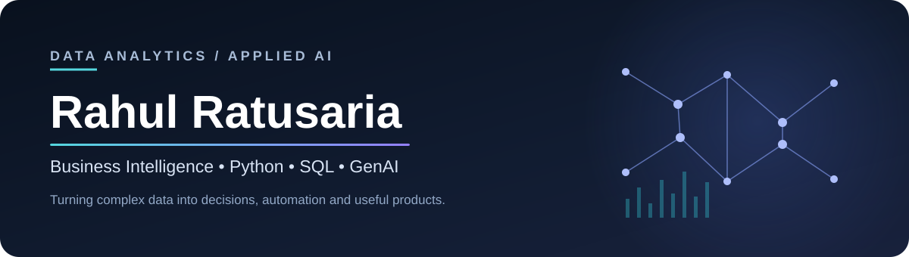

### Data Analyst · Business Intelligence · Applied AI Builder

*I turn complex datasets into actionable insights, automate repetitive workflows, and build practical AI-powered tools.*

## 👋 About me

I'm a **Data Analyst with experience in business intelligence, analytics automation, and stakeholder-focused problem solving**. My work spans SQL/Python analysis, interactive dashboards, survey and operational data, and developing workflows that help teams act on insights faster.

Beyond my core analytics work, I explore **Generative AI, NLP, RAG and agentic workflows** to make analysis and reporting more scalable. I'm particularly interested in bridging the gap between *technical implementation* and *real-world business decisions*.

- 📊 **Analytics:** KPI frameworks, data quality, segmentation, business insights and executive reporting
- ⚙️ **Automation:** Python-based data processing, repeatable reporting and workflow improvements
- 🤖 **Applied AI:** LLM-powered insight generation, document analysis, NLP and LangGraph
- 🎯 **Approach:** Define the business problem → validate data → analyze → communicate → operationalize

## 🧭 What I work on

| Area | Focus |
| :--- | :--- |
| 📈 **Business & Product Analytics** | KPI design, trend analysis, segmentation, root-cause analysis and decision support |
| 🗃️ **Business Intelligence** | Power BI, Excel, dashboard design, stakeholder reporting and data storytelling |
| 🐍 **Data Engineering & Automation** | Python, SQL, pandas, data quality checks, process automation and reporting pipelines |
| 🧠 **Machine Learning & NLP** | Classification, text analysis, model evaluation and practical ML workflows |
| ✨ **Generative & Agentic AI** | RAG, prompt workflows, LangGraph, LLM-assisted analysis and insight generation |

## 🛠️ Tech stack

**Analytics & Engineering**

**Machine Learning & AI**

**Core tools and frameworks**

      

## 🚀 Selected projects

### 🔎 LLM-Powered Business Insight Generator

A LangGraph-based workflow to transform uploaded business reports into concise, decision-oriented summaries, analytical observations and next-step recommendations.

**Focus:** LangGraph · LLMs · Report analysis · Automated insight generation

[**Explore repository ↗**](https://github.com/Rahul-Ratusaria/insight_generator-langgraph)

### 🛒 E-commerce Analytics with Microsoft Fabric

An end-to-end analytics project using the Olist Brazilian e-commerce dataset to explore business performance through a Fabric Lakehouse and Power BI reporting workflow.

**Focus:** Microsoft Fabric · Lakehouse · Power BI · E-commerce KPIs

[**Explore repository ↗**](https://github.com/Rahul-Ratusaria/fabric-olist-ecommerce-analytics)

### 💼 Productivity Dashboard

An interactive Streamlit tool to track tasks, monitor progress and organize personal reflections in one workspace.

**Focus:** Python · Streamlit · Interactive dashboards

[**Explore repository ↗**](https://github.com/Rahul-Ratusaria/productivity-dashboard)

### 🏋️ AI Gym Helper

A practical fitness-focused project exploring how interactive tools can support workout guidance and training workflows.

**Focus:** Applied AI · Fitness technology · User-focused product design

*Repository link to be added when confirmed.*

## 🔬 Currently exploring

- Agentic workflows that combine data analysis with LLM reasoning
- RAG quality, grounding and document intelligence
- AI-assisted executive reporting and business decision support
- Evaluation, observability and reliable deployment of AI applications

## 📊 GitHub activity

> GitHub cards are generated by third-party services and may occasionally be unavailable. GitHub's native contribution calendar is visible below this README on the profile page.

## 🤝 Let's connect

I'm interested in **Data Analyst, Business Analyst, Business Intelligence, Product Analytics and Applied AI opportunities** that combine analytical rigor, business context and meaningful implementation.

**Browse my work:** [github.com/Rahul-Ratusaria](https://github.com/Rahul-Ratusaria)  
**Portfolio:** [rahul-ratusaria.github.io](https://rahul-ratusaria.github.io/)

---

Data → Insights → Decisions → Impact

